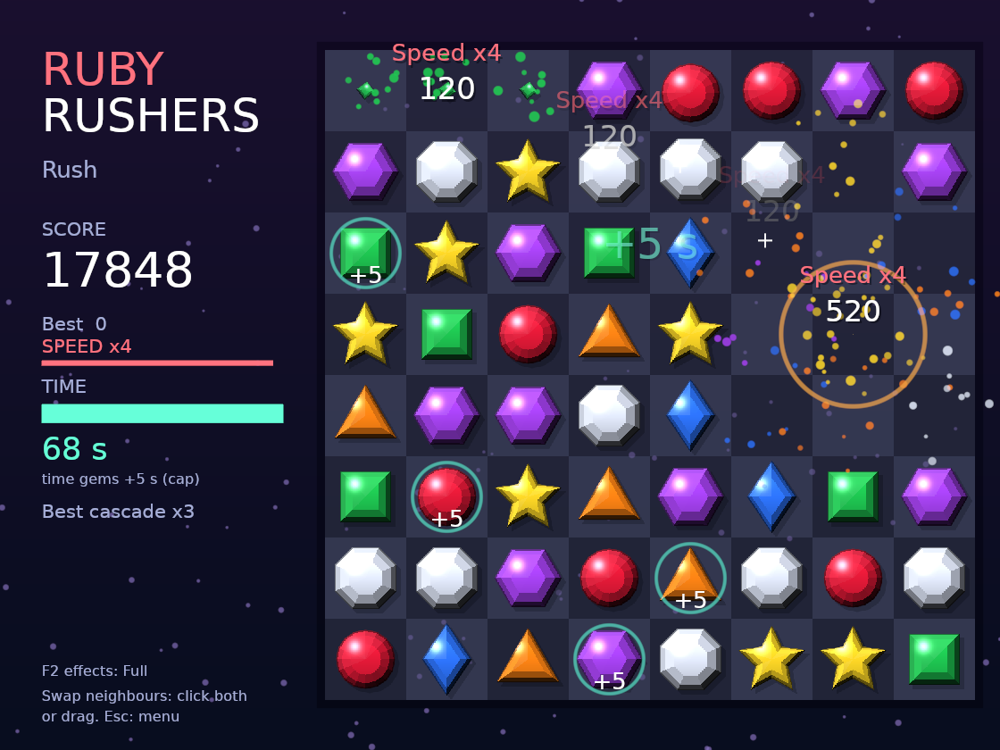
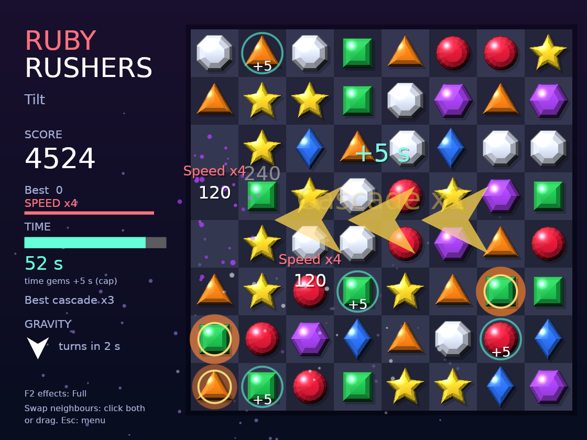

# RubyRushers

A fast match-three gem game built on [game-toolkit](https://github.com/sunsided/game-toolkit).
Swap neighbouring gems to line up three or more; bigger lines leave special gems behind.

**[Play it in the browser](https://sunsided.github.io/rubyrushers/)**

<p>
  
  
</p>

*Both captured from the bot playing (Rush, and Tilt two seconds before gravity turns).*

- **Rush**: 60 seconds on the clock, time gems add more. Stuck boards are reshuffled.
  Time gems follow `--time cap` (+5 s each, +60 s at most; the default) or `--time fade`
  (+5 s, then half a second less each, down to +1 s); on the web `?time=fade`.
- **Endless**: no clock; the game ends when no move is left.
- **Tilt**: like Rush, but gravity turns a quarter clockwise every 15 seconds (down, left,
  up, right). Arrows warn just before; the board settles, then gems fall the new way.

Special gems:

| Match | Earns | When cleared |
|-------|-------|--------------|
| 4 in a line | Bomb (glowing ring) | clears the 3×3 around it |
| L or T shape | Cross (white plus) | clears its row and column |
| 5 in a line | Wild (rainbow orb) | swap it with a gem to clear that colour; two wilds clear the board |

Chain reactions score a cascade multiplier, and matches in quick succession (within
2.5 s) build a speed streak worth +50% per level. Best scores are kept per mode.

## Run

```sh
task run                      # or: cargo run --release
task run -- --mode tilt       # skip the title (rush, endless, tilt; also --seed, --calm)
task screenshot MODE=endless  # save a frame to screenshots/window.png
task web                      # in the browser at http://localhost:8080
```

Click a gem and then a neighbour, or drag a gem onto a neighbour. Keep going while
cascades still fall: any gem at rest can be swapped. F2 switches the effects between
Full and Calm (no shake, spin, glints or pulsing; picked automatically when the browser
asks for reduced motion, or with `--calm`). F12 saves a screenshot, Esc goes back to the
title. Linux needs `libasound2-dev libdbus-1-dev libudev-dev pkg-config`.

## The bot

`bot/` is an autoplayer that sees the game only through screenshots, successor to
[rubyrush](https://github.com/sunsided/rubyrush) and the main reason this game exists
in the first place. To keep things fair while cheating, it never links the game: it finds
the board as a lattice of gem-shaped blobs, reads each gem by its hue, picks a swap with its
own idea of the rules, and clicks, in a Chromium it drives over the DevTools protocol.

```sh
task bot                              # headless, Rush, calm effects
task bot -- --mode tilt --visible     # watch it play
task bot:watch                        # ... and see what it sees and thinks
task bot:endless                      # watch it play Endless, until no move is left
task bot:accuracy                     # grade its reading against seeded games
```

It reads boards perfectly in both effect levels and plays as fast as it can: any cell
two readings in a row agree on is fair game, without waiting for the board to rest.
Each candidate swap is simulated until the board settles (matches, special gems,
gravity, cascades; new gems unknown), and scored with the best follow-up on that
predicted board, so a small match that sets up a big one can win. In Endless, where
running out of moves ends the game, it waits for the board to settle and also values
the moves a swap leaves open. Next: special gems, gravity in Tilt, deeper search.

`--watch` opens a window beside the game with the bot's view, live: the pixels it
captured, the tiles it read from them (solid where it trusts them, hollow where two
readings disagreed, framed where its own moves are still at work), the board it expects
once its move has settled, the move that sets up next, and every move it weighed.


## License

[EUPL-1.2](LICENSE).
