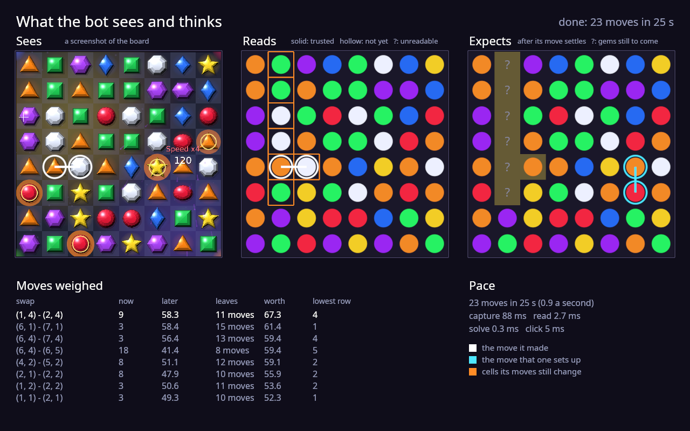

# rubyrushers-bot

My third go at a bot that plays a match-three game from screenshots: the first one clicked its way through a Flash game in 2010, the second spent 2015 cutting tiles and never played at all, and this one, sixteen years after the first, gets all the way from pixels to a sensible move without me pointing at the board. It finds the 8×8 lattice on its own, reads the gems by hue, simulates every swap down to the last cascade, and clicks, all without ever linking the game it plays. The game, admittedly, plays along: everything it draws between the gems stays dark and unsaturated, so the bot has an easier time telling gems from decoration. A little cheating for the cheater, then.



## Earlier attempts

The first, [rubyrush](https://github.com/sunsided/rubyrush), came together over five days in May 2010 in C# and WinForms, against Bejeweled Blitz on Facebook, back when it was a Flash game in the browser. It grabbed the desktop through GDI, and I had to drag a rectangle from the first gem to the last by hand, with a red 8×8 grid drawn along so I could line it up. The colour sampler split that rectangle into seven steps per side, as one would expect; the mouse, however, divided it by 7.25 horizontally and 7.75 vertically (found by fair dice roll, or close enough). Each cell's colour was averaged over a diamond-shaped patch (pointy gems like triangles and diamonds pick up less background that way) and snapped to the nearest of seven reference RGB values. Moves came from a tree of hand-written patterns (`XXO`, `XOX`, `XXOXX-Bomb` and friends) loaded from an XML file, each with a fixed rank. The best two were played back to back, 155 ms apart, each by dragging the mouse ten steps of three pixels through `mouse_event`. The last commit message of that week reports a score of 449,050.

The second, in 2015, never got to play at all. The idea was to train a classifier on the game's tiles, so I recorded screenshots and cut them into 41-pixel tiles, first in MATLAB and then in C#; the pitch came from two neighbouring grid corners I picked by hand, each a 2×2 block of pixels because the corner sat between them. Their centres are (208.5, 65.5) and (208.5, 106.5), so one tile is 41 pixels tall, a subtraction I had Wolfram Alpha do for me (the query is still in a code comment). After two and a half weeks it had produced a folder of assorted tiles and no classifier, and that is where it stayed.

The new bot keeps the idea and replaces nearly everything else:

- It finds the board on its own instead of being told where it is.
- It reads hues instead of distances to fixed RGB values, and reads every board correctly in both the calm and the full effect level.
- It doesn't wait for a still board (outside Endless) and instead tracks which cells it can trust.
- It simulates each swap, cascades included, rather than matching it against a list of shapes, so a new special gem means a change to the simulation, not a new XML pattern.
- It plays in a browser it controls instead of on the desktop, so it can run headless, and the accuracy test can check its reading against the truth.
- It waits for its own moves to land instead of firing the next one after a fixed sleep.

This time, it also got a game of its own: RubyRushers exists mainly so that this bot has something to play.

## Running it

From the workspace root, with [trunk](https://trunkrs.dev/) and a Chrome or Chromium on the `PATH` (or in `$BOT_CHROME`):

```sh
task bot                              # headless, Rush, calm effects
task bot -- --mode tilt --visible     # watch it play
task bot:watch                        # ... and see what it sees and thinks
task bot:endless                      # watch it play Endless, until no move is left
task bot:accuracy                     # grade its reading against seeded games
```

Each of these builds the web version into `dist/` first; the bot then serves that folder itself on a free local port. The flags, all optional:

| Flag | Does |
|---|---|
| `--dist <dir>` / `--url <url>` | Serve a web build (default `dist`), or play one that is already running. |
| `--mode rush\|endless\|tilt` | The game mode (default `rush`). |
| `--full` | Full effects instead of calm ones. |
| `--visible` | Show the browser window instead of running headless. |
| `--watch` / `--watch-shot <file.png>` | Open the viewer; the second form saves a picture of it at the end and closes it. |
| `--secs <n>` | Stop after this many seconds (default 600). |
| `--seed <n>`, `--time cap\|fade` | Passed on to the game. |
| `--mobility <w>` | How much it values the moves a swap leaves open (default 15 in Endless, 0 elsewhere). |
| `--shot <file.png>` | Save a screenshot of the final page. |

## How it works

On Wayland, grabbing the screen and moving the mouse from another program is a chore, and the game already had a WASM build. So instead, the bot plays the web build in a Chrome it starts itself. It talks to Chrome over the DevTools protocol through a small blocking websocket client of its own (`cdp.rs`): one command at a time, events ignored. That covers screenshots and mouse clicks, which is all it needs. Each round has the same four steps: capture, read, solve, and click.

**Finding the board.** Nothing about the game's layout is hard-coded. `grid.rs` collects every 4-connected patch of colourful (or bright white) pixels and looks for 64 of them of similar size sitting on a regular 8×8 lattice; the lattice gives the top-left cell and the pitch. Once found, only that rectangle gets captured, which keeps screenshots small and rounds fast.

**Reading the gems.** `read.rs` looks at a patch around each cell's centre, inside any halo or ring the game draws around a gem, and takes the dominant hue of the colourful pixels. Six reference hues and white make the seven colour classes; a cell with hardly any colourful pixels is white if it is bright and unknown otherwise, and one whose hues are all over the place is a rainbow gem.

**Trusting what it read.** The game keeps running while the bot looks: gems fall, swap, and vanish. A cell is only trusted when two readings in a row agree and none of the bot's own recent moves is still expected to change it (those cells stay off limits for 700 ms: swap, clear, and fall). Any move among trusted cells may be played, so in Rush and Tilt the bot plays while the rest of the board is still busy.

**Picking a swap.** `sim.rs` has the bot's own idea of the rules: for a swap, it finds the matches, the special gems they leave behind, the gems falling into the gaps, and the cascades that follow. Gems that would fall in from above are unknown, so the predicted board fills up with question marks from the top. `solver.rs` values every legal swap by what it clears now plus the best move it sets up on that predicted board, discounted by 0.7 (it may never happen). A small match that lines up a big one can therefore beat the big one now.

**Endless is different.** Without a clock there's no hurry, but a board without moves ends the game. Here the bot waits until the whole board reads still, and a swap earns a bonus for the moves it leaves open: `mobility * ln(1 + moves left)`. Going from no move left to one is worth about ten points, from ten to eleven about one. I tried it on four seeds: with a weight of 15 every game outlasted three minutes, with 6 or none most ended within one.

**Knowing when it's over.** Four seconds without a move it can trust, or three moves in a row that change nothing (a finished game may still show its board, dimmed under the final score), and the bot considers the game over.

## Watching it think

`--watch` runs the bot on a worker thread and opens a [game-toolkit](https://docs.rs/game-toolkit) window beside the browser with three boards: the pixels it captured (**Sees**), the tiles it read from them (**Reads**: solid where it trusts them, hollow where two readings disagreed, framed in orange where its own moves are still at work), and the board it expects once its move has settled (**Expects**: `?` where new gems will drop in, the move it sets up in cyan). Below that are the moves it weighed and how long each step of the round took.

## Grading it

`tests/accuracy.rs` is the one place that looks at the game's actual state, and the only reason the game crate shows up in `[dev-dependencies]`. The web build deals seeded boards (`?mode=endless&seed=3`), the bot reads them from screenshots, and the game's own idea of the board grades the reading. It needs Chrome and a web build, so it is `#[ignore]`d by default; `task bot:accuracy` runs it.
